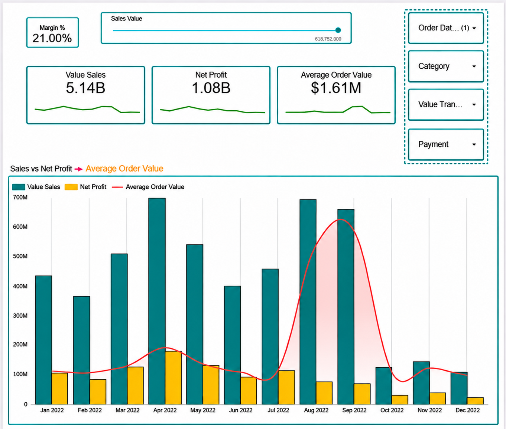
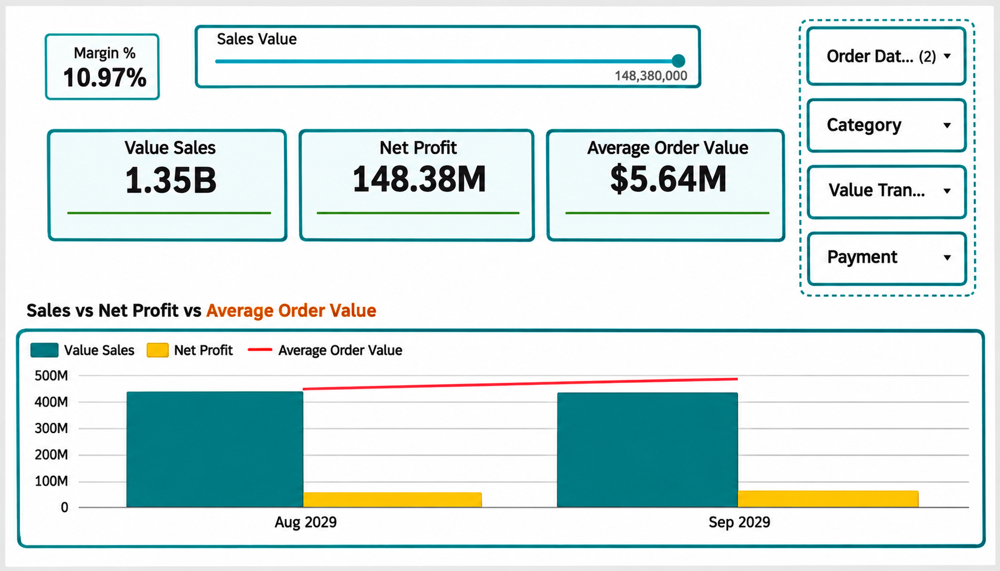
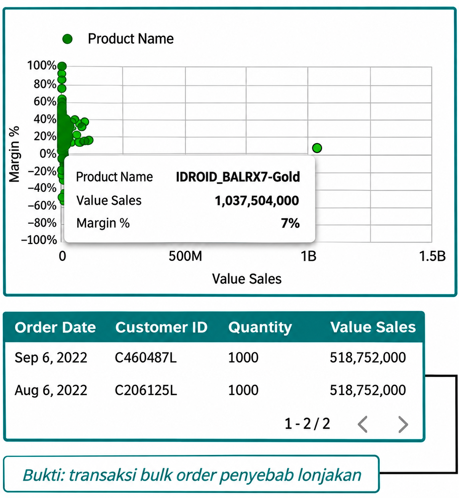
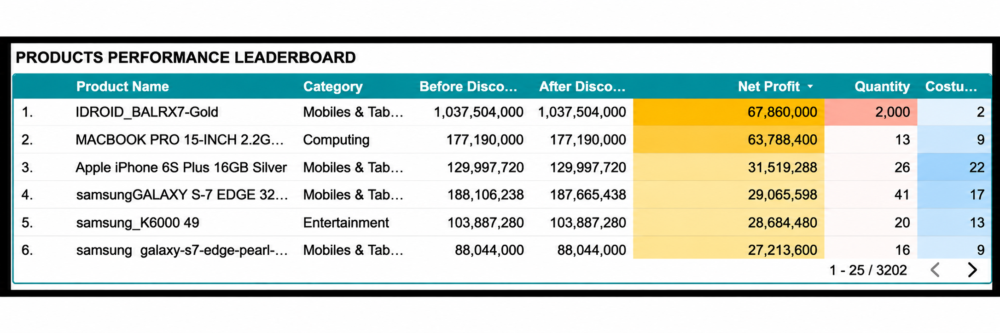
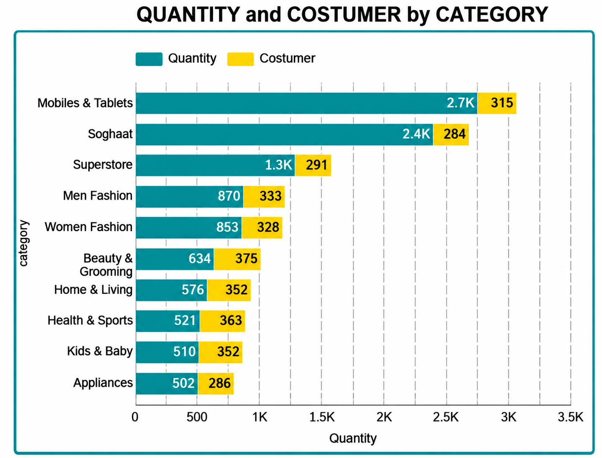
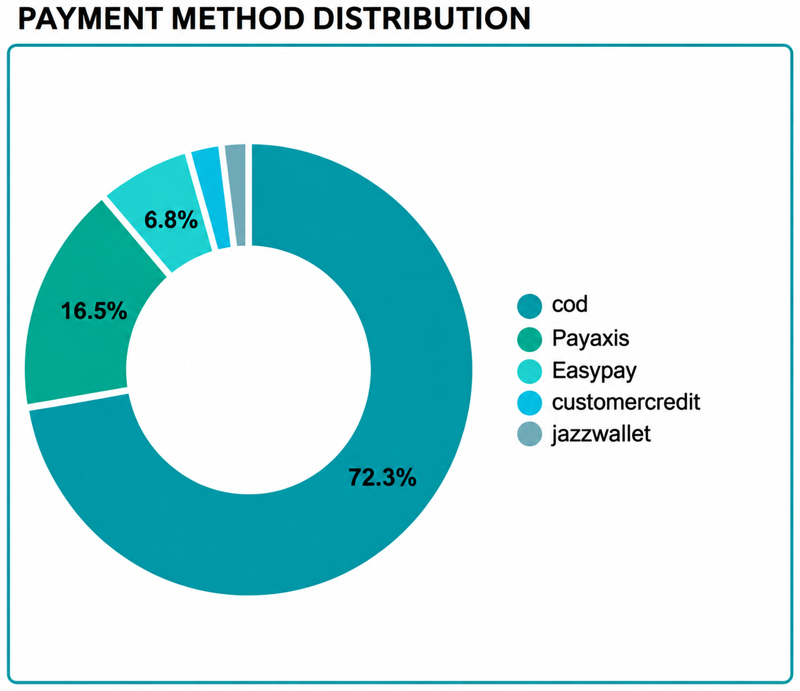

# tokopaedi-sales-analysis-Looker | Google Looker Studio

## Gambaran Proyek

Proyek ini berisi pembuatan dashboard interaktif menggunakan **Google Looker Studio** untuk memantau dan mengevaluasi performa penjualan bulanan **Tokopaedi** (data dummy e-commerce) sepanjang tahun 2022. Sebelum dimasukkan ke Looker Studio, data dicek terlebih dahulu menggunakan **Python (pandas)** untuk memastikan tidak ada data kosong atau error.

Dashboard ini dibuat menjadi 2 halaman sesuai permintaan dari Tim Marketing:
+ **Halaman 1 (Tren Penjualan & Profitabilitas 2022):** Melihat hubungan antara nilai penjualan kotor (*Value Sales*), keuntungan bersih (*Net Profit*), dan rata-rata nilai belanja per pesanan (*Average Order Value / AOV*) setiap bulannya di tahun 2022.
+ **Halaman 2 (Performa Produk, Kategori & Metode Pembayaran):** Menampilkan rincian performa tiap produk dan kategori, proporsi metode pembayaran yang dipakai pelanggan, serta mengecek transaksi kategori *Mobiles & Tablets* yang menggunakan metode pembayaran *Jazzwallet* di tahun 2022.

**Link Penting:**
+ **Dashboard Interaktif (Google Looker Studio):** [Dashboard](https://datastudio.google.com/u/0/reporting/23cda0ed-b04c-49c9-8932-0a1c7d013b4f)
+ **Dataset CSV:** [`df - df.csv`](dataset/df%20-%20df.csv) ([Raw CSV](https://raw.githubusercontent.com/fadhlulikram/tokopaedi-sales-analysis-Looker/refs/heads/main/dataset/df%20-%20df.csv))

## **Daftar Isi**
- [Data & Pengecekan Awal](#data--pengecekan-awal)
- [Hasil Visualisasi & Analisis](#hasil-visualisasi--analisis)
- [Kesimpulan Singkat](#kesimpulan-singkat)
- [Saran](#saran)

---

## Data & Pengecekan Awal

Dataset yang digunakan adalah tabel gabungan transaksi `order_detail` sebanyak **5.884 baris** yang mencakup informasi pesanan, produk, pelanggan, dan metode pembayaran. 

Beberapa pengecekan awal (*data profiling*) yang dilakukan di Python sebelum visualisasi:
+ **Tipe Data & Nilai Kosong:** Mengubah kolom `order_date` dan `registered_date` menjadi format tanggal (`datetime`). Seluruh kolom sudah dicek dan tidak ada nilai yang kosong (*null*).
+ **Duplikasi ID Order:** Ditemukan 120 `id` order yang muncul lebih dari sekali. Setelah dicek, datanya tetap valid karena dalam satu nomor pesanan pelanggan membeli beberapa jenis barang (*multi-produk*).
+ **Kolom Tambahan (Calculated Fields di Looker Studio):**
  + **`Value Sales`**: Total nilai penjualan sebelum diskon (`before_discount`).
  + **`Net Profit`**: Keuntungan bersih dengan rumus `before_discount - (cogs * qty_ordered)`.
  + **`AOV (Average Order Value)`**: Rata-rata nilai per transaksi dengan rumus `SUM(before_discount) / COUNT_DISTINCT(id)`.
  + **`Margin %`**: Persentase keuntungan bersih terhadap penjualan kotor dengan rumus `Net Profit / Value Sales`.
  + **`Value Transaction`**: Mengubah angka `is_valid` menjadi teks `"Valid"` (`is_valid = 1`) dan `"Not Valid"` (`is_valid = 0`) untuk dipakai sebagai filter.

---

## Hasil Visualisasi & Analisis

### 1. Halaman 1: Tren Value Sales, Net Profit, dan AOV (Tahun 2022)
Pada halaman pertama, dibuat grafik kombinasi batang dan garis untuk memantau pergerakan penjualan (*Value Sales*), laba bersih (*Net Profit*), serta rata-rata nilai transaksi (*AOV*) dari Januari hingga Desember 2022 (khusus transaksi `Valid`).

**Temuan dari Dashboard Halaman 1:**
+ **Performa Keseluruhan 2022:** Total penjualan (*Value Sales*) selama tahun 2022 mencapai **Rp5,14 miliar** dengan keuntungan bersih (*Net Profit*) sebesar **Rp1,08 miliar** (rata-rata margin tahunan **21,00%**) dan rata-rata belanja per transaksi (*AOV*) sebesar **Rp1,61 juta**.
+ **Keanehan di Bulan Agustus & September:** Pada grafik terlihat *Value Sales* dan garis *AOV* melonjak sangat tinggi di bulan Agustus dan September 2022 (total *Value Sales* dua bulan tersebut mencapai **Rp1,35 miliar** dengan *AOV* **Rp5,64 juta**). Namun, batang *Net Profit*-nya justru kecil (**Rp148,38 juta**) sehingga margin keuntungannya turun menjadi **10,97%**.

<table>
  <tr>
    <td align="left" valign="top">
      
  </tr>
</table>

+ **Penyebab Lonjakan (Transaksi Partai Besar / Bulk Order):** Setelah dicek menggunakan grafik *scatter plot* dan tabel rincian transaksi, lonjakan di bulan Agustus–September ternyata bukan karena ramainya pelanggan yang belanja, melainkan karena adanya **2 transaksi borongan (*bulk order*)** produk **IDROID_BALRX7-Gold** masing-masing sebanyak **1.000 unit** (senilai Rp518,75 juta per transaksi) pada tanggal 6 Agustus dan 6 September 2022. Karena margin produk tersebut tipis (sekitar 7%), nilai penjualan terlihat besar tetapi keuntungan bersihnya kecil. Selain itu, mulai bulan Oktober hingga Desember penjualan reguler terlihat turun drastis.

<table>
  <tr>
    <td align="left" valign="top">
      
    </td>
  </tr>
</table>

---

### 2. Halaman 2: Performa Produk, Kategori & Metode Pembayaran
Halaman kedua menampilkan tabel rincian produk, perbandingan kuantitas barang vs jumlah pembeli per kategori, proporsi metode pembayaran, serta pengecekan transaksi metode *Jazzwallet*.

**Temuan dari Dashboard Halaman 2:**
+ **Perbandingan Kuantitas vs Jumlah Pembeli per Kategori:**
  + Kategori **Mobiles & Tablets** (2,7 ribu unit dari 315 pelanggan) dan **Soghaat** (2,4 ribu unit dari 284 pelanggan) memiliki jumlah barang terjual paling banyak meskipun jumlah pembelinya tidak sebanyak kategori lain. Artinya, pelanggan di kategori ini cenderung membeli dalam jumlah banyak sekaligus.
<table>
  <tr>
    <td align="left" valign="top">
      
    </td>
  </tr>
</table>

  + Sebaliknya, kategori seperti **Beauty & Grooming** (375 pelanggan, 634 unit), **Health & Sports** (363 pelanggan, 521 unit), dan **Home & Living** (352 pelanggan, 576 unit) memiliki jumlah pembeli unik yang lebih ramai, tetapi rata-rata hanya membeli 1–2 barang per orang.

<table>
  <tr>
    <td align="right" valign="top">
      
    </td>
  </tr>
</table>

+ **Metode Pembayaran Didominasi COD:** Sebanyak **72,3%** transaksi menggunakan metode *Cash on Delivery (COD)*, disusul oleh *Payaxis* (16,5%) dan *Easypay* (6,8%). Penggunaan pembayaran digital masih cukup sedikit (di bawah 30%).

---

## Kesimpulan Singkat

+ **Lonjakan Penjualan Agustus–September Bersifat Semu:** Tingginya *Value Sales* dan *AOV* di bulan Agustus dan September 2022 disumbang oleh 2 transaksi *bulk order* (masing-masing 1.000 unit *IDROID_BALRX7-Gold*) dengan margin keuntungan yang tipis, sehingga *Net Profit* tidak ikut naik tinggi.
+ **Penurunan Transaksi di Akhir Tahun:** Memasuki bulan Oktober hingga Desember 2022, nilai penjualan dan keuntungan turun cukup jauh dibanding paruh pertama tahun 2022.
+ **Ketergantungan Tinggi pada COD:** Hampir tiga perempat (72,3%) transaksi masih mengandalkan pembayaran tunai lewat kurir (COD).
+ **Transaksi Jazzwallet Nihil di Mobiles & Tablets:** Tidak ditemukan transaksi yang memakai *Jazzwallet* pada kategori *Mobiles & Tablets* selama tahun 2022.

## Saran

+ **Evaluasi & Promo Kuartal Akhir:** Cek kembali apakah penurunan transaksi di bulan Oktober–Desember disebabkan oleh berkurangnya aktivitas kampanye iklan, lalu terapkan kembali program promo seperti di bulan Maret–Mei untuk mengangkat penjualan reguler.
+ **Pisahkan Evaluasi Transaksi Borongan (Bulk Order):** Saat mengevaluasi target *AOV* dan penjualan bulanan, pisahkan transaksi pesanan borongan (seperti pembelian 1.000 unit oleh 1 pelanggan) dari transaksi ritel biasa supaya tim Marketing bisa membaca tren penjualan harian dengan lebih akurat.
+ **Strategi Bundling untuk Kategori Ramai Pembeli:** Pada kategori yang punya banyak pelanggan tapi jumlah unit belinya sedikit (seperti *Beauty & Grooming*, *Health & Sports*, dan *Home & Living*), buat promo paket (*product bundling*) atau diskon beli lebih dari 1 item supaya rata-rata nilai belanja (*AOV*) meningkat.
+ **Kurangi Ketergantungan COD & Cek Metode Pembayaran:** Berikan promo *cashback* atau potongan ongkir khusus pembayaran non-tunai (*e-wallet* / transfer) supaya risiko operasional COD berkurang, serta periksa apakah opsi pembayaran *Jazzwallet* memang belum diaktifkan untuk produk-produk *Mobiles & Tablets*.
